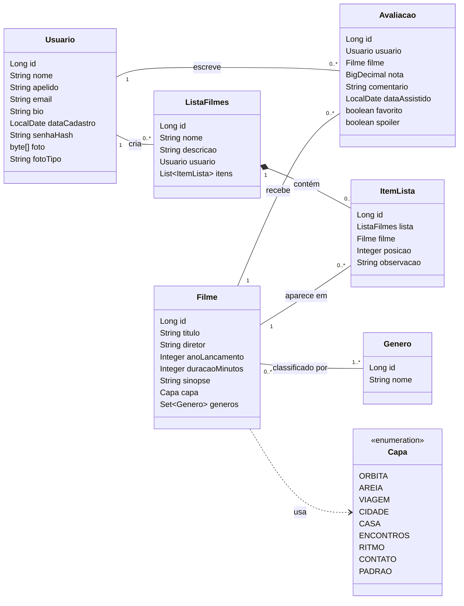
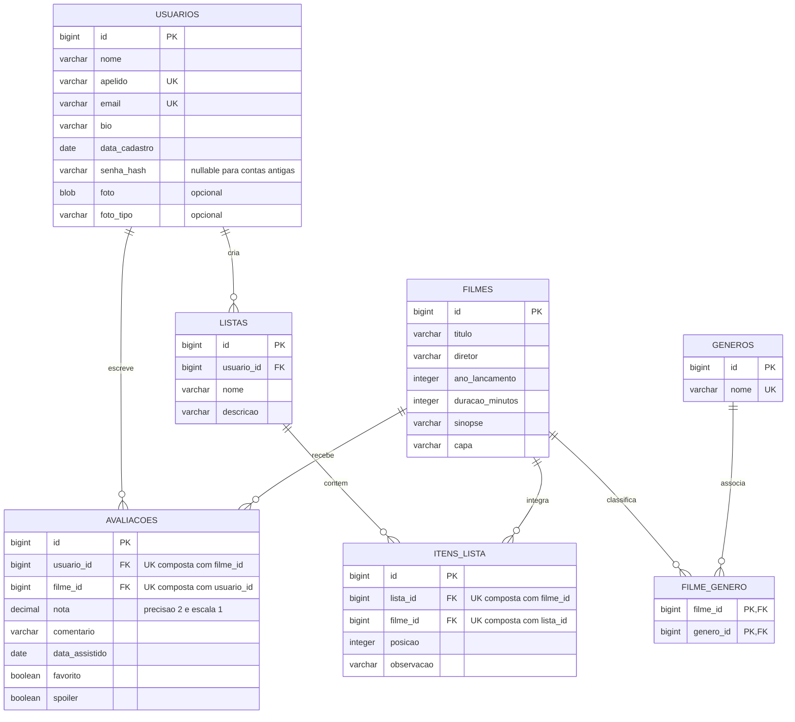

# CineBox — autenticação e perfil individual

Diário de cinema inspirado no Letterboxd. **Spring Boot 3.5.7, Spring MVC, Thymeleaf, Spring Data JPA, Spring Security e H2**. Mantém a arquitetura MVC e as 7 tabelas relacionais do projeto.

Esta versão substitui a identificação manual de autores por **autenticação real com sessão**. É uma entrega de código-fonte local: nada foi instalado, compilado, iniciado, publicado, sincronizado ou conectado a serviços para preparar esta reformulação. Não foram feitos downloads de dependências. Os testes abaixo foram escritos, mas **não executados**.

## O que mudou

- Cadastro em `/cadastro` e login por **e-mail + senha** em `/login`.
- Senhas armazenadas como **hash BCrypt**, nunca em texto puro; confirmação de senha e validação de tamanho.
- Todas as funcionalidades principais exigem login. Só login, cadastro e arquivos estáticos são públicos.
- Logout por **POST**, encerrando a sessão e removendo o cookie de sessão.
- Avaliações não têm campo, seletor ou ID de autor no formulário/DTO. O Service obtém o ID do principal autenticado.
- Uma pessoa só pode editar/excluir suas próprias avaliações, mesmo alterando URLs ou parâmetros manualmente.
- O diário e o perfil mostram somente avaliações da conta logada. As avaliações no detalhe de um filme continuam compartilhadas; os controles de edição aparecem apenas para o autor.
- O botão superior direito agora é **Meu perfil**, com foto e apelido da conta atual.
- Perfil com nome, apelido, e-mail privado, bio, data de cadastro e grade dos filmes avaliados, com pôster, título, nota e link para o filme.
- Edição dos próprios dados e upload/remoção de foto PNG/JPEG no H2. Imagem genérica local quando não há foto.
- As listas também recebem automaticamente o autor da sessão; somente o autor gerencia a lista e seus itens. A leitura das listas continua compartilhada.
- A seção Pessoas foi mantida para consulta de perfis básicos, sem expor e-mails ou permitir gerenciar outras contas. A gestão da própria conta fica no perfil.
- Proteção CSRF em todos os POSTs, inclusive login, cadastro e logout; proteção contra fixação de sessão e cookie HttpOnly/SameSite.
- Compatibilidade com os registros anteriores, sem apagar ou reatribuir avaliações e listas.

## Rodar no seu ambiente

Requisitos: **JDK 17 ou 21 e Maven 3.9+**. Java 8 não é compatível. Não precisa instalar servidor de banco, Docker ou qualquer serviço externo.

1. Extraia todo o ZIP.
2. Entre na pasta `cinebox`, onde está `pom.xml`.
3. Execute:

```sh
mvn spring-boot:run
```

Ou use `iniciar.bat` no Windows / `sh iniciar.sh` em Linux/macOS. Acesse **http://127.0.0.1:8080**; você será encaminhado ao login. Clique em **Criar conta**, cadastre-se e entre com o e-mail e a senha escolhidos. Depois do login, o destino é o próprio perfil. Para parar, use Ctrl+C.

**Quando você executar pela primeira vez, o Maven poderá baixar as dependências públicas no seu ambiente.** A aplicação em si não faz chamadas a APIs, CDNs, serviços de identidade, GitHub, Docol ou outros serviços externos. Escuta apenas em `127.0.0.1`; CSS, scripts e imagens são locais.

Com todas as dependências já em cache, use `mvn -o spring-boot:run` sem rede. Para mudar a porta:

```sh
mvn spring-boot:run -Dspring-boot.run.arguments=--server.port=8081
```

## Banco novo e exemplos

O H2 persiste em `data/cinebox.mv.db`, relativo à pasta de onde o programa é iniciado. `ddl-auto=update` adapta as entidades. O console web do H2 permanece desativado.

Se o banco estiver vazio, `app.dados-exemplo=true` cria os filmes, gêneros, avaliações e listas de demonstração anteriores. **Os perfis fictícios dos exemplos não recebem senha padrão e não podem fazer login.** Crie sua própria conta para testar. Você verá as avaliações fictícias nos detalhes dos filmes, mas seu perfil/diário começa vazio.

Para começar sem exemplos, configure `app.dados-exemplo=false` antes da primeira execução. O inicializador não reaplica exemplos quando já existem cadastros principais.

## Atualizar um banco da primeira versão

1. Pare a versão antiga e faça uma **cópia de segurança** da pasta `data`.
2. Coloque a pasta `data` existente na raiz desta versão, ao lado do `pom.xml`. Não misture bancos e não abra duas versões ao mesmo tempo.
3. Inicie a nova aplicação normalmente. Hibernate adiciona `senha_hash`, `foto` e `foto_tipo`, todos inicialmente opcionais para preservar as linhas antigas.
4. IDs e FKs existentes permanecem iguais. As avaliações antigas continuam ligadas ao mesmo usuário e filme, e compõem as mesmas médias.
5. As contas antigas sem senha não podem entrar até que o responsável pelo banco defina a senha pelo comando **local e interativo** abaixo. Não existe ativação pública por e-mail, nem senha compartilhada.

### Definir a primeira senha de uma conta antiga

Depois de gerar o JAR, **pare o servidor** e, em um terminal interativo na pasta do projeto, execute:

```sh
mvn clean package
java -jar target/cinebox-1.0.0.jar --ativar-conta-legada
```

O programa solicita o e-mail existente, uma nova senha e sua confirmação, sem mostrar a senha digitada. Esse modo usa somente o banco local, **não inicia servidor HTTP** e não altera contas que já têm senha. Execute-o como responsável pelo arquivo local do banco, em ambiente pessoal/autorizado. Não há processo de comprovação por e-mail porque a aplicação não envia mensagens: o acesso ao arquivo/terminal local é a autoridade administrativa desta operação.

Após definir a senha, rode a aplicação normalmente e faça login com esse e-mail. O perfil mostrará as avaliações antigas da mesma conta. Não crie outra conta com outro e-mail esperando transferir as avaliações: a autoria existente é preservada, não transferida.

Se `System.console()` não estiver disponível (ex.: console de uma IDE ou execução com entrada redirecionada), esse comando encerra sem alterar dados. Use `java -jar` em um terminal interativo. Nunca passe senhas em argumentos, scripts ou arquivos.

Detalhes: [compatibilidade e banco](docs/AUTENTICACAO-E-COMPATIBILIDADE.md).

## Testar os cenários solicitados

1. Abra `/cadastro`, crie a conta A e entre em `/login`.
2. Em outra janela anônima, tente abrir `/filmes`, `/avaliacoes` e `/perfil`: deve exigir login.
3. Com A logada, registre um filme: não há seletor de pessoa.
4. Confira a avaliação no diário e no perfil de A; autor e nota devem corresponder a A.
5. Saia da conta usando **Sair da conta** no perfil.
6. Crie e entre com uma conta B. O perfil/diário não deve mostrar os filmes avaliados apenas por A.
7. Avalie um filme com B. Saia e volte a A: cada perfil deve mostrar somente suas próprias avaliações.
8. Teste edição de perfil, foto e remoção de foto. Tente alterar uma URL de edição/exclusão de avaliação ou lista de outro usuário: deve negar a operação.

[Roteiro completo de testes](docs/ROTEIRO-DE-TESTES.md).

### Testes automatizados

```sh
mvn test
```

Há **25 testes** de integração/compatibilidade, incluindo autenticação real pelos filtros Spring Security, sessões independentes, CSRF, autor forjado, isolamento dos perfis, propriedade de registros, upload de foto, logout e atualização de um esquema H2 antigo em memória.

Eles usam H2 **em memória** e não modificam `data/cinebox.mv.db`. Não foram executados nesta entrega, assim como a aplicação e a compilação, para respeitar o pedido de apenas reformular os arquivos. A revisão realizada foi estática, dos arquivos e vínculos; não equivale a validar a aplicação em execução.

Para gerar e executar o JAR por conta própria:

```sh
mvn clean package
java -jar target/cinebox-1.0.0.jar
```

## Estrutura MVC e rotas

- `model/entity`: entidades JPA, com a mesma autoria por FK já existente.
- `model/repository`: consultas de banco e consultas de avaliações filtradas pelo usuário.
- `model/service`: cadastro, foto, regras, propriedade dos registros e transações.
- `security`: carregamento de credenciais, principal com ID estável e consulta da identidade da sessão.
- `config`: BCrypt, regras de segurança e dados de exemplo.
- `controller`: controllers MVC; nenhum acessa Repository diretamente.
- `templates`: login, cadastro, perfil e telas existentes.

[Arquitetura e rotas detalhadas](docs/ARQUITETURA.md).

Os CRUDs de filmes e gêneros, busca, filtros, capas, médias, favoritos, spoilers e itens de listas foram mantidos. O catálogo é compartilhado e pode ser gerenciado por qualquer conta autenticada; não foi criado um papel de administrador que não existia no projeto.

## Diagramas

[Classes em SVG](docs/diagrama-classes.svg) · [MER em SVG](docs/mer.svg) · [SQL de referência](docs/schema-referencia.sql)





`senha_hash` é nullable somente para permitir contas antigas ainda não ativadas; o cadastro novo sempre grava um hash. Foto e tipo são opcionais. As tabelas permanecem: `usuarios`, `filmes`, `generos`, `filme_genero`, `avaliacoes`, `listas`, `itens_lista`.

## Protótipos

[Mapa de telas](prototipos/mapa.html) · [Prévia do perfil](prototipos/perfil.html) · [Prévia do login](prototipos/login.html)

Os HTMLs em `prototipos` são documentação visual sem persistência; o funcionamento real está na aplicação Spring em `src/main`. Extraia o ZIP e abra os protótipos localmente. Não são usados para autenticar a aplicação.

## Escopo

Sem OAuth, serviços de identidade, e-mail, recuperação de senha online, bibliotecas de fotos remotas, hospedagem ou integração corporativa. Autenticação por sessão com 30 minutos de inatividade. As sessões ficam no servidor em memória e encerram com a parada do processo; cadastros, hashes, fotos e avaliações ficam no H2. Sem opção de manter login por cookie persistente.

É uma aplicação acadêmica local. O endereço padrão fica restrito ao computador onde você escolher executá-la. Nenhum repositório remoto foi criado ou atualizado. As capas SVG seguem ilustrativas, não são cartazes oficiais.


## Imagens dos filmes

O catálogo utiliza o banco H2 em arquivo (`./data/cinebox`), integrado ao Spring Data JPA. Os dados dos filmes são persistidos nesse banco. O cadastro e a edição permitem enviar um pôster em JPG, PNG ou WEBP, com limite de 2 MB. O arquivo é armazenado como BLOB na própria tabela `filmes`, junto com o tipo MIME, e servido pela rota `/filmes/{id}/imagem`.

Se um filme não tiver imagem enviada, o sistema continua exibindo a capa ilustrada padrão. Ao editar um filme, deixar o campo de imagem vazio mantém o pôster já salvo. Para substituir, basta selecionar outro arquivo. A atualização automática do esquema (`spring.jpa.hibernate.ddl-auto=update`) adiciona as novas colunas sem apagar os registros existentes.
