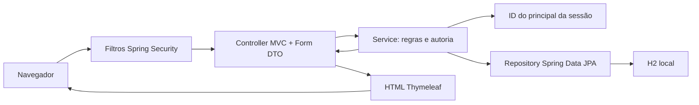

# Arquitetura e rotas

Controllers não importam nem injetam Repository. Segurança de propriedade é verificada no Service, além das restrições de rota. Entidades e FKs existentes foram preservadas. `open-in-view=false` permanece; `EntityGraph` carrega filmes/autores/itens antes da renderização. Textos continuam escapados por `th:text`.

## Conta

| Método/rota | Comportamento |
|---|---|
| GET `/login` | Tela pública de login |
| POST `/login` | Filtro do Spring Security autentica e cria sessão |
| GET `/cadastro` | Formulário público de cadastro |
| POST `/cadastro` | Valida e salva conta com hash BCrypt |
| POST `/logout` | Invalida sessão, remove cookie e volta ao login |
| GET `/perfil` | Perfil e avaliações da conta da sessão |
| GET/POST `/perfil/editar` | Edita somente o titular; upload multipart opcional |
| GET `/perfil/foto` | Bytes da foto da própria conta, sem cache |
| GET/POST `/perfil/excluir` | Confirma senha; exclui titular sem vínculos e encerra sessão |
| GET `/pessoas` | Consulta de nomes, apelidos, bios e data de cadastro |

URLs antigas GET `/pessoas/{id}/editar` e `/pessoas/{id}/excluir` redirecionam ao próprio perfil somente se o ID é do titular; outros IDs são negados. POSTs antigos de cadastro/edição/exclusão de terceiros foram retirados para não criar um caminho paralelo sem autorização.

## Recursos existentes, agora autenticados

| Recurso | Listagem | Cadastro | Edição | Confirmação de exclusão |
|---|---|---|---|---|
| Filme | GET `/filmes` | GET `/filmes/novo` | GET `/filmes/{id}/editar` | GET `/filmes/{id}/excluir` |
| Gênero | GET `/generos` | GET `/generos/novo` | GET `/generos/{id}/editar` | GET `/generos/{id}/excluir` |
| Avaliação própria | GET `/avaliacoes` | GET `/avaliacoes/novo` | GET `/avaliacoes/{id}/editar` | GET `/avaliacoes/{id}/excluir` |
| Lista | GET `/listas` | GET `/listas/novo` | GET `/listas/{id}/editar` | GET `/listas/{id}/excluir` |

Para cada recurso: POST `/recurso` cria; POST `/recurso/{id}` atualiza; POST `/recurso/{id}/excluir` exclui. Escritas exigem token CSRF e usam redirecionamento após sucesso.

- GET `/` redireciona para o catálogo; anônimos são antes enviados ao login.
- GET `/filmes?q=texto&generoId=ID` combina busca e filtro.
- GET `/filmes/{id}` exibe detalhes, média e avaliações compartilhadas.
- GET `/avaliacoes/novo?filmeId=ID` pré-seleciona somente o filme, nunca o autor.
- GET `/listas/{id}` exibe a lista; o formulário de inclusão e os controles só aparecem para o dono.
- POST `/listas/{id}/itens` adiciona filme à própria lista.
- GET `/listas/{id}/itens/{itemId}/editar` e POST `/listas/{id}/itens/{itemId}` editam item próprio.
- GET e POST `/listas/{id}/itens/{itemId}/excluir` confirmam/removem item próprio.

## Organização adicional

`security/AutenticacaoService` lê credenciais do banco; `security/UsuarioAutenticado` representa o principal e `security/SessaoUsuarioService` fornece o ID confiável aos Services. `SenhasConfig` define BCrypt e `SegurancaConfig` define filtros e sessão. O modo interativo para contas antigas fica no ponto de entrada `CineboxApplication` e não expõe rota HTTP.

## Respostas

Erros de formulário exibem mensagens sem perder dados comuns (senhas/fotos precisam ser preenchidas novamente). Recurso inexistente ou alheio: 404; permissão/CSRF: 403; parâmetro inválido: 400; conflito concorrente de integridade: 409; upload acima do limite de requisição: 413. O registro de foto é validado também no Service. Não são mostrados stack traces ou hashes no HTML.
